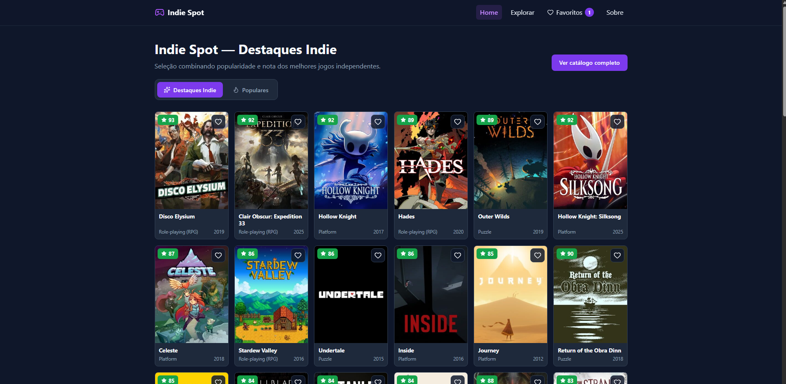
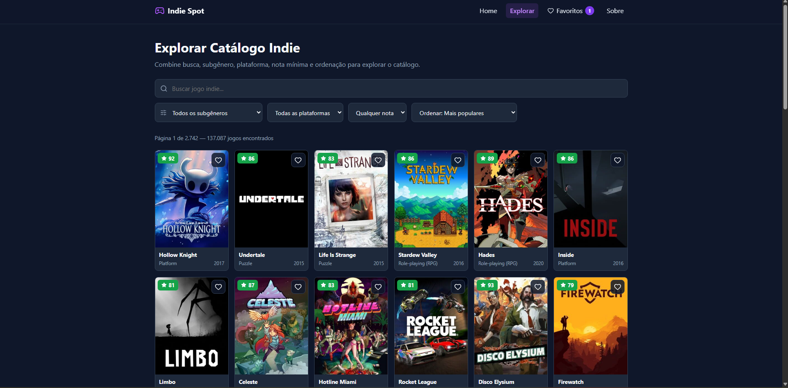
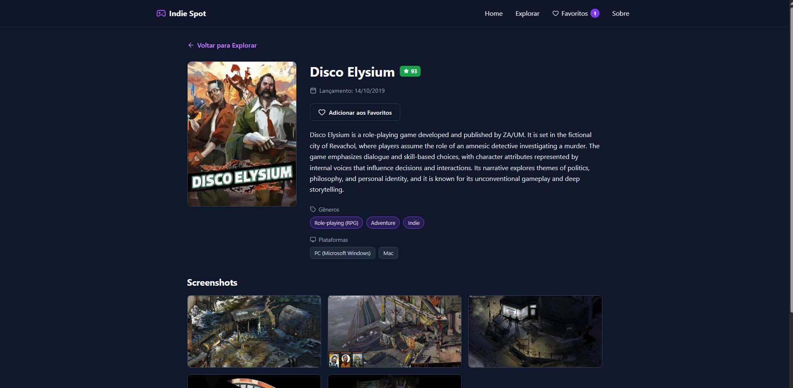
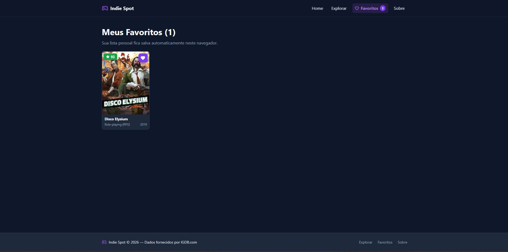
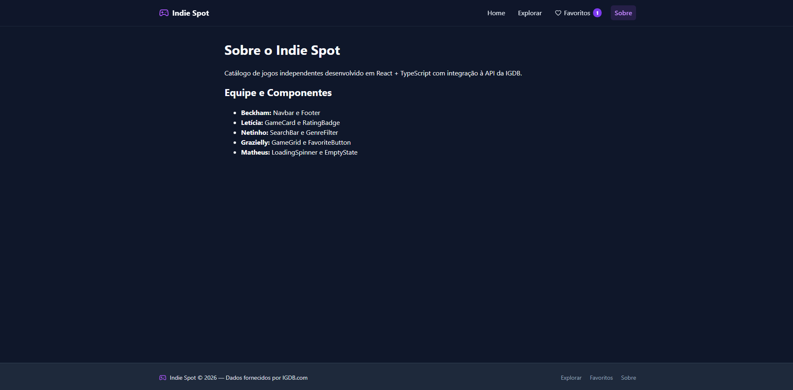

# 🎮 Indie Spot — Catálogo de Jogos Independentes

Aplicação web desenvolvida em **React + TypeScript + Vite** para a disciplina de **Front-end Frameworks (AV2 — Análise e Desenvolvimento de Sistemas)**. O **Indie Spot** permite descobrir jogos independentes em destaque e populares no momento, explorar o catálogo com busca, filtros avançados e paginação, visualizar detalhes completos com screenshots e gerenciar uma lista pessoal de favoritos persistida no navegador.

- **Deploy (Vercel):** [https://indie-spot.vercel.app](https://indie-spot.vercel.app)
- **API utilizada:** [IGDB API v4](https://api-docs.igdb.com/) (via função serverless `api/games.ts` com autenticação OAuth2 da Twitch)

## Requisitos da AV2 Atendidos

| Requisito | Exigência | Implementação no Indie Spot |
| :--- | :--- | :--- |
| **Linguagem** | TypeScript obrigatório | 100% do projeto escrito em `.ts` e `.tsx` com interfaces tipadas (`IGDBGame`, `IGDBImage`, `IGDBTag`) |
| **Componentes Funcionais** | Mínimo 8 (2 por integrante) | **10 componentes funcionais** divididos entre os 5 membros do grupo |
| **Navegação / Páginas** | Mínimo 5 páginas distintas | **5 rotas** com `react-router-dom`: Home (`/`), Explorar (`/explorar`), Detalhes (`/jogo/:id`), Favoritos (`/favoritos`) e Sobre (`/sobre`) |
| **Hooks** | Ao menos 4 hooks diferentes | `useState`, `useEffect`, `useContext`, `useMemo` + custom hooks `useDebounce`, `useGames` e `useFavorites` (além de `useParams`) |
| **Backend / API Real (extra)** | Integração com API real ou backend próprio | Função serverless `api/games.ts` na Vercel consumindo `/v4/games`, `/v4/games/count` e `/v4/popularity_primitives` da [IGDB API](https://api-docs.igdb.com/) |

## Equipe e Componentes Desenvolvidos

| Integrante | Componentes Funcionais | Arquivos | Responsabilidade Principal |
| :--- | :--- | :--- | :--- |
| **Beckham** | `Navbar` e `Footer` | `src/components/layout/Navbar.tsx`<br>`src/components/layout/Footer.tsx` | Navegação global com destaque de rota ativa (`NavLink`), contador dinâmico de favoritos e rodapé com créditos da IGDB |
| **Letícia** | `GameCard` e `RatingBadge` | `src/components/games/GameCard.tsx`<br>`src/components/games/RatingBadge.tsx` | Card responsivo de cada jogo (capa `3:4`, gênero, ano, link para detalhes) e selo de nota com cor condicional |
| **Netinho** | `SearchBar` e `GenreFilter` | `src/components/games/SearchBar.tsx`<br>`src/components/games/GenreFilter.tsx` | Campo de busca controlado com botão de limpar e seletor com 15 subgêneros oficiais da IGDB |
| **Grazielly** | `GameGrid` e `FavoriteButton` | `src/components/games/GameGrid.tsx`<br>`src/components/ui/FavoriteButton.tsx` | Grade responsiva (6 colunas no desktop / 4 no mobile) e botão de favoritar integrado ao `FavoritesContext` |
| **Matheus** | `LoadingSpinner` e `EmptyState` | `src/components/ui/LoadingSpinner.tsx`<br>`src/components/ui/EmptyState.tsx` | Indicador animado de carregamento e estado vazio/erro reutilizável com ação de retorno |

## Principais Funcionalidades

- **Página Inicial (`Home`):** alternância entre **Destaques Indie** (ranking ponderado de popularidade + nota) e **Populares** (jogos indie mais jogados recentemente via `popularity_primitives` da [IGDB API](https://api-docs.igdb.com/)).
- **Explorar Catálogo (`Explore`):** busca com debounce de 400ms, filtro por **15 subgêneros**, **plataforma**, **nota mínima** (`70+`, `80+`, `90+`), **ordenação** (Mais populares, Melhor avaliados, Mais recentes, A–Z), botão **Limpar filtros** e **paginação numérica** de 50 jogos por página.
- **Detalhes do Jogo (`GameDetails`):** capa em alta resolução, nota, data de lançamento formatada em `pt-BR`, sinopse, tags de gêneros e plataformas, botão de favoritar e galeria de screenshots.
- **Meus Favoritos (`Favorites`):** lista pessoal salva automaticamente em `localStorage` (`@indie-spot:favorites`) e sincronizada em tempo real com o contador da `Navbar`.

## Estrutura do Projeto

```text
indie-spot/
├── api/
│   └── games.ts                # Função serverless (Vercel) para autenticação Twitch + IGDB API v4
├── src/
│   ├── components/
│   │   ├── games/              # GameCard, GameGrid, GenreFilter, RatingBadge, SearchBar
│   │   ├── layout/             # Navbar, Footer
│   │   └── ui/                 # EmptyState, FavoriteButton, LoadingSpinner
│   ├── contexts/
│   │   └── FavoritesContext.tsx # Estado global de favoritos com persistência em localStorage
│   ├── hooks/
│   │   ├── useDebounce.ts      # Atraso de 400ms na digitação da busca
│   │   └── useGames.ts         # Busca paginada, filtros e controle de loading/erro
│   ├── pages/                  # Home, Explore, GameDetails, Favorites, About
│   ├── routes/
│   │   └── AppRoutes.tsx       # Configuração das 5 rotas + layout global
│   ├── services/
│   │   └── igdbService.ts      # Chamadas à API /api/games e formatação de imagens da IGDB
│   └── types/
│       └── game.ts             # Interfaces TypeScript (IGDBGame, IGDBImage, IGDBTag)
├── vercel.json                 # Rewrites para /api e SPA fallback
└── vite.config.ts              # Proxy de /api para a Vercel em desenvolvimento local
```

## Pré-requisitos e Instalação

### 1. Pré-requisitos
- **Node.js** (versão LTS v18 ou superior) — verifique com `node -v` e `npm -v`
- **VS Code** (ou editor de sua preferência)

### 2. Clonar e instalar dependências

```bash
git clone <https://github.com/Dvd-Beckham/Indie-spot>
cd indie-spot
npm install
```

### 3. Rodar em modo de desenvolvimento

```bash
npm run dev
```

Abra o endereço exibido no terminal (normalmente `http://localhost:5173`). O arquivo `vite.config.ts` já possui proxy configurado para redirecionar `/api` para a instância publicada na Vercel, permitindo testar o front-end localmente sem configurar chaves da Twitch.

### 4. Gerar build de produção (validação TypeScript + Vite)

```bash
npm run build
```

### 5. Rodar a API serverless localmente *(opcional)*

Caso queira testar alterações em `api/games.ts` localmente antes do deploy, crie um arquivo `.env.local` na raiz do projeto com suas credenciais de aplicativo da Twitch:

```env
TWITCH_CLIENT_ID=seu_client_id
TWITCH_CLIENT_SECRET=seu_client_secret
```

E execute:

```bash
npx vercel dev
```

## Prints das Telas Principais

### Página Inicial — Destaques Indie e Populares


### Explorar Catálogo — Busca, Filtros e Paginação


### Detalhes do Jogo


### Meus Favoritos


### Sobre o Projeto



## Tecnologias Utilizadas

- **React 19** & **TypeScript**
- **Vite 8**
- **React Router DOM 7**
- **Lucide React** (ícones)
- **Vercel Serverless Functions** + **[IGDB API v4](https://api-docs.igdb.com/)**
